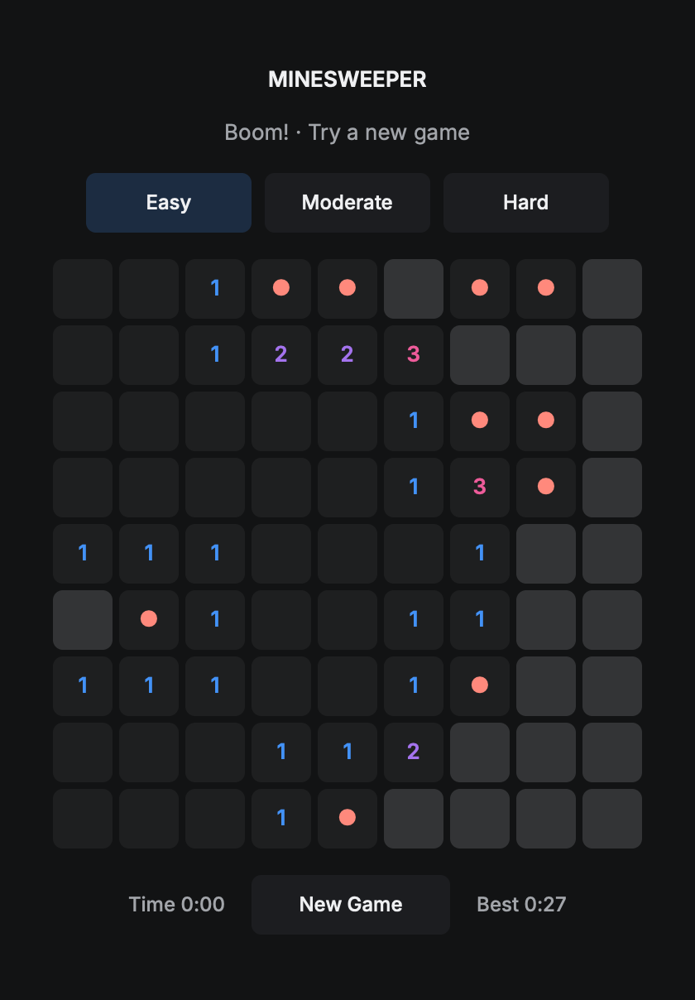

# Minesweeper Rune

A small native Minesweeper game written in Rust with [Rune](https://github.com/anomalyco/rune).



## Features

- Easy, Moderate, and Hard difficulty modes
- Safe first move and automatic empty-cell expansion
- Timer and the persistent best time for each difficulty
- Keyboard-accessible cells and controls

## Controls

- **Left-click:** Reveal a cell
- **Right-click:** Toggle a flag
- **Double-click a revealed number:** Reveal adjacent cells when the nearby flag count matches the number
- **New Game:** Restart the current difficulty

## Run

```sh
cargo run
```

## Test

```sh
cargo test
```
